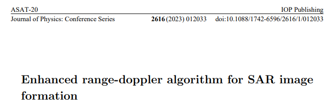
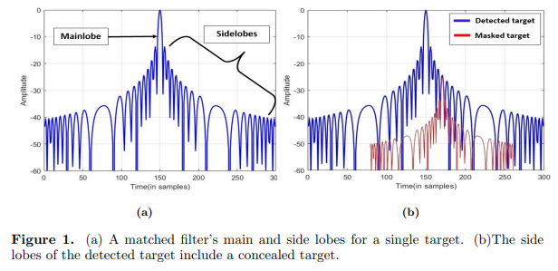
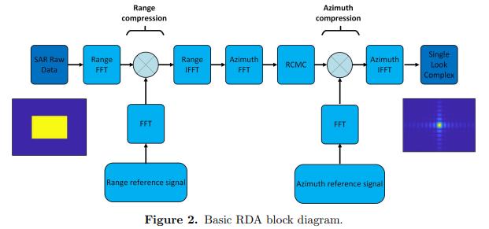
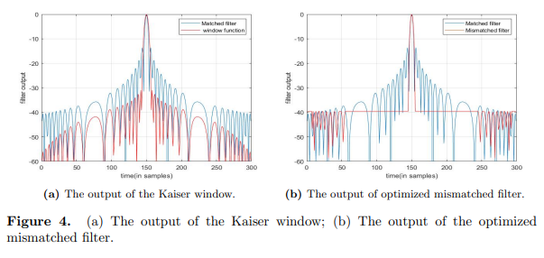
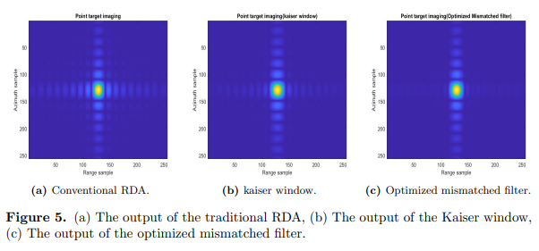
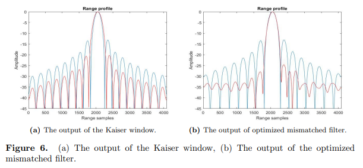
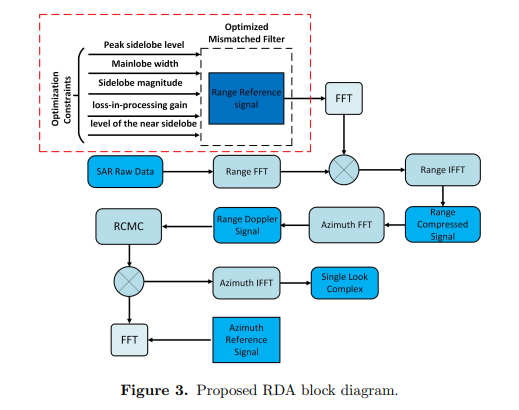
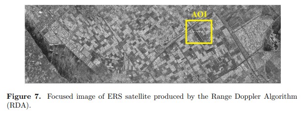
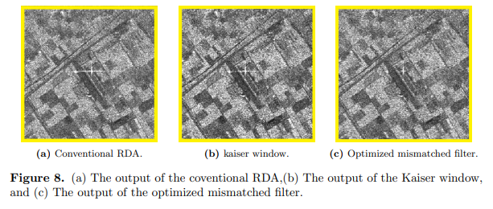

# [SAR Imaging] Breakthrough in Sidelobes! Enhanced Distance-Doppler SAR Imaging Algorithm Based on Convex Optimization: A Deep Analysis with MATLAB Code

Breaking the constraint of sidelobes! A deep analysis of an enhanced distance-Doppler SAR imaging algorithm based on convex optimization
Keywords: Synthetic Aperture Radar (SAR), Distance Doppler Algorithm (RDA), Pulse Compression, Mismatched Filter, Secondary Constraint Quadratic Programming (QCQP), Sidelobe suppression
Authors: M. Sakr, A. S. Amein et al., a joint research team from multiple universities
In the field of all-weather, all-day remote sensing detection, Synthetic Aperture Radar (SAR) is an indispensable core equipment, widely used in military reconnaissance, land observation, ocean monitoring, disaster early warning, and other scenarios.
The **Distance Doppler Algorithm (RDA)**, with its simple structure, convenient motion compensation, and easy balance between computing power and accuracy, has become the mainstream processing algorithm for SAR imaging. However, traditional RDA has inherent defects: the high sidelobes generated by the matched filter can mask weak targets, reduce image signal-to-noise ratio and resolution.
This paper will comprehensively dissect the enhanced RDA algorithm based on QCQP convex optimization from the perspectives of research background, core principles, algorithm design, experimental verification to the final conclusion, allowing you to thoroughly understand all theoretical details and core technological advantages.
I. Abstract (Key Points for Quick Reading): SAR relies on pulse compression technology to achieve long-range detection and high-resolution imaging. RDA is a classic pulse compression algorithm for coherent SAR data imaging. When using linear frequency modulation (LFM) signals combined with matched filters for pulse compression, higher sidelobes are produced. The sidelobes of strong scattering points easily obscure nearby weak targets, severely degrading imaging quality.
The current industry mainstream solution is to add Taylor, Hamming, Cascade windows at the receiving end to suppress sidelobes. However, this approach has a fatal flaw: it widens the main lobe and loses signal-to-noise ratio (SNR), falling into the dilemma of "sidelobe reduction = resolution decline".
To address this industry pain point, this paper proposes an enhanced RDA algorithm based on mismatched filter optimization: introducing a secondary constraint quadratic programming (QCQP) convex optimization model to design an optimal mismatched filter instead of traditional window functions. This approach can significantly lower image sidelobes without expanding the main lobe, achieving a significant improvement in image quality.
Research employs three authoritative quantitative metrics for SAR imaging: Peak Sidelobe Ratio (PSLR), Integrated Sidelobe Ratio (ISLR), and Pulse Response Width (IRW) to verify the product comprehensively. The experimental results fully demonstrate that this enhanced algorithm possesses robustness, efficiency, and reliability. Compared to traditional RDA and windowed RDA, it significantly enhances sidelobe suppression capabilities while perfectly preserving high resolution, enabling the output of higher quality SAR images.
Introduction: Technological Challenges and Research Necessity of Traditional SAR-RDA
1. Basic Cognition of SAR and RDA
SAR is an active microwave remote sensing technology, distinct from traditional optical imaging. It operates without restrictions due to lighting, clouds, fog, or rain, capable of working day and night continuously, making it a core ground detection equipment for both military and civilian use.
The core imaging logic relies on the formation of "synthetic aperture" through radar platform movement, combined with pulse compression technology, using wide pulses for long-distance detection, while also enhancing distance resolution through pulse compression, balancing detection distance and imaging precision.
RDA was born in 1978 and is currently the most widely used SAR imaging algorithm in engineering applications. The algorithm completes distance-axis and azimuth-axis data processing using Fast Fourier Transform (FFT), efficiently compensating for distance-related characteristics such as range motion and Doppler centroid, with mature architecture, stable computation, and low implementation difficulty.
2. Deadly Problems of Current Conventional Pulse Compression
Currently, the mainstream SAR system uses linear frequency modulation (LFM, chirped signal) as the transmitting signal, paired with a matched filter for pulse compression. In ideal single target scenarios, the peak sidelobe ratio (PSLR) output by the matched filter is fixed at **-13 dB**, which is inherently a theoretical flaw.
However, in real detection scenarios, there are numerous weak and strong scattering targets, leading to significant sidelobe energy. This can cause a series of imaging issues:
- Weak targets being obscured: The sidelobe energy of strong scattering points covers adjacent weak targets, causing missed detection of small or concealed targets, resulting in failed target identification;
Signal-to-Noise Ratio (SNR) significantly drops: Sidelobe clutter interferes with the effective echo signal, diluting target features and reducing the overall SNR of the image;
Image distortion and blurring: The overlapping of multiple target sidelobes causes image smearing and edge blurring, severely affecting subsequent target classification, feature extraction, and other post-processing tasks.
3. Limitations of Existing Solutions: Common sidelobe suppression methods in the industry add window functions such as Casorati windows, Hamming windows, Blackman windows at the receiving end. However, these solutions are subject to performance trade-offs that cannot be avoided:
✅ Advantage: It can reduce sidelobes to about -40 dB, effectively suppressing sidelobe clutter;
❌ Disadvantage: The main lobe width significantly expands, imaging resolution decreases, while radar processing gain is reduced and SNR further degrades.
In short, traditional window addition algorithms are typical "cutting one wall to patch another," solving the problem of sidelobe interference but sacrificing the core resolution performance of SAR imaging.
Therefore, developing a new pulse compression algorithm without window constraints, high sidelobe suppression, preservation of main lobe, and resolution, has become an urgent research direction in the field of high-resolution SAR imaging.
4. Core Research Approach of This Paper: This study completely breaks away from the traditional technical framework of "adding windows to suppress sidelobes," starting from the optimization of filtering logic at the filter level:
Abandoning traditional fixed matching filters, it autonomously designs an optimal mismatch filter; transforming the complex issue of sidelobe optimization into a convex optimization mathematical problem of QCQP, solving for global optimal filter coefficients through multi-layer physical constraints, ultimately integrating into the classic RDA process to upgrade the full-link performance of SAR imaging.
(1) Standard Process of Traditional Range-Doppler Algorithm (RDA): The standard RDA is a two-dimensional step-by-step processing architecture, which mainly consists of three modules: range-processing, range-motion correction, and azimuth-processing, with the complete imaging process as follows:
1  
Original data distance FFT: Conduct a distance-domain Fourier transform on the SAR raw echo data, converting the time domain data into the frequency domain;
2  
Range pulse compression: Multiply the frequency-domain data with the LFM reference signal (matched filter), completing the preliminary pulse compression to enhance the range resolution;
Distance-Time Forward Transform: Reverses the frequency domain data to obtain preliminary focus-direction signals;
4
Azimuth Fast Fourier Transform: Data transformed into the range-Doppler domain (R-D domain), separating and extracting azimuth Doppler information;
5
Range Migration Correction (RCMC): Corrects the offset issues caused by radar platform motion, aligning scattered target echoes to the same range cell;
6
Azimuth Pulse Compression: Matches filtering in the range-Doppler domain with an azimuth reference signal to achieve focusing in the azimuth direction;
7
Azimuth Inverse Fast Fourier Transform: Data is reversed back to the time domain, ultimately generating a single-look complex SAR image.
The core bottleneck of the entire algorithm lies in the pulse compression in the range direction, with the inherent high sidelobe problem of the matching filter permeating the entire process, also being the focal point of this algorithm optimization.
(II) Based on QCQP for Mismatched Filter Optimization Model (Core Theory) The traditional matching filter is designed specifically for "single target, maximum signal-to-noise ratio" and is completely unsuitable for multi-target detection scenarios in real scenes. This study innovatively uses mismatched filters instead of matching filters, and converts the filter design into a multi-constraint QCQP convex optimization problem.
The core advantage of convex optimization algorithms: Solving results are global optimal solutions, without local optima traps, and have extremely strong performance stability.
1. Mathematical modeling of signals and filters: The LFM signal received by SAR is represented as a vector of length:
Design the coefficient vector of the mismatched filter of length ();
The convolution operation between the signal and the filter can be converted into matrix computation:
Where is the constructed dimension-related matrix, used to describe the convolution mapping relationship between the signal and the filter.
Special case of matching filter: When and (are the conjugate vectors of the signal), that is the classic matching filter, maximizing energy under a single target, but with extremely high sidelobe amplitude;
Core goal of mismatched filter: Abandon maximizing energy under a single target to minimize sidelobe amplitude, while strictly constraining key engineering indicators such as main lobe width and signal-to-noise ratio loss.
2. Optimization Objectives and Multi-Layer Constraints (Complete QCQP Model)
(1) Core optimization objectives
For infinite norm (maximum value of orientation), the core logic is to minimize the largest magnitude in all sidelobes; the matrix is a diagonal matrix, specifically shielding the main lobe area, and only optimize constraints for sidelobes.
(2) The five core physical constraints aim to prevent the optimization results from deviating from engineering reality. By adding five layers of rigid constraints, we precisely balance three core indicators: sidelobe suppression, main lobe shape, and signal-to-noise ratio loss.
1  
Non-zero solution constraints: Ensure the output of the filter is an effective signal, avoid null solutions, and maintain the core energy of the original signal; it is a conjugate transpose matrix for signals.
2  
3  
Far-side lobe constraint: This is the number of sampling points for the main lobe, constraining the amplitude of far-side lobes. It achieves suppression of far-side lobes by minimizing this constraint.
4  
Main lobe shape constraint: Precisely define the amplitude of all sampling points in the main lobe, eliminating the issue of main lobe expansion from a mathematical perspective. This is the core key advantage over traditional windowing algorithms.
5  
Near-side lobe constraint: Individually constrains the transition between the main lobe and the far-side lobe, refining the global shape of the sidelobes, resulting in more uniform imaging effects.
(3) The solution tool research is based on MATLAB platform, calling CVX convex optimization toolbox and SDPT3 solver to solve QCQP model numerically, finally output the global optimal mismatch filter coefficients. This solution scheme has low computational complexity and stable convergence, fully adapting to SAR real-time imaging processing scenarios.
3. Algorithm execution steps 1
Initialization parameters: input LFM signal, number of main lobe width sampling points, maximum allowable loss of SNR;
2  
Build QCQP convex optimization model, write five-layer constraints and core optimization objectives;
3  
Invoke CVX toolbox to iteratively solve, output optimal mismatch filter coefficients;
4  
Incorporate optimized filter coefficients into the RDA algorithm for distance-direction pulse compression imaging.
(III) Enhanced RDA Overall Architecture
1  
Offline Filter Pre-optimization: Based on LFM reference signal, solve the optimal mismatch filter (once solved and reused repeatedly) through QCQP algorithm.
2  
The SAR raw echo data has completed the distance-Doppler FFT transformation.
3  
Core Improvement: Multiplying the frequency domain data with the optimized mismatch filter instead of the traditional matched filter/windowed filter to achieve high-precision distance-direction pulse compression.
4  
Distance towards IFFT transformation, obtain sidelobe suppression, main lobe without spreading of the focused signal;
5  
Adopting the traditional RDA process: Azimuth FFT → Distance Displacement Correction → Azimuth Pulse Compression → Azimuth IFFT;
6  
Output high-resolution, low-noise quality SAR images.
Core Innovation Summary: By using QCQP convex optimization to replace traditional windowing filters, the inherent contradiction of "sidelobe suppression and resolution compromise" in SAR imaging is fundamentally resolved.
IV. Experimental Design and Results Analysis (Quantitative + Visualization Double Verification) The study employs dual datasets: simulated point target data + real satellite SAR data from the ERS, to test three mainstream algorithms: traditional RDA, Caesar window-augmented RDA, and the enhanced RDA proposed in this paper. Performance is comprehensively verified through visual effects and three major quantitative indicators.
1. ERS satellite-borne SAR experimental basic parameters:
5.3 GHz  
Number of distance sampling points
2048  
Pulse repetition frequency (PRF)
1679.902 Hz  
Frequency modulation slope
418.98 GHz  
Parallel distance
852358.15 m  
Sampling frequency
18.962 GHz  
Pulse Duration
37.12 μs
Wavelength
0.05656 m
Platform Movement Speed
7098.0194 m/s
Azimuth Sampling Points
2048
2. The three core evaluation indicators are defined in this experiment using the authoritative quantitative metrics commonly used in the SAR imaging field, ensuring data objectivity and high recognition:
1. Peak Sidelobe Ratio (PSLR, dB): The logarithmic ratio of the peak sidelobe intensity to the maximum sidelobe intensity, with a smaller value indicating better sidelobe suppression. Formula: (Sidelobe Peak Intensity; Main Beam Peak Intensity)
2. Integrated Sidelobe Ratio (ISLR, dB): The logarithmic ratio of the total energy of all sidelobes to the main beam energy, reflecting the overall clutter level of the image, with a smaller value indicating cleaner images.
3. Pulse Response Width (IRW, m): The width at 3dB of the main beam, directly corresponding to the imaging spatial resolution, with a smaller value indicating higher imaging resolution.
3. Simulation results for point targets:
(1) Single signal output comparison with Caesar window: PSLR = -30.9723 dB, sidelobes are suppressed but the main beam is significantly widened, resulting in reduced resolution;
In this paper, we optimized the mismatch filter: PSLR = -39.5752 dB, sidelobe suppression effect far exceeds that of the Caesar window, there is no significant widening of the main beam width, perfectly balancing both indicators.
(2) Quantitative indicators comparison between algorithm types: PSLR (dB), ISLR (dB), IRW (m)
Traditional RDA
-13.1109
-10.3473
3.6012
Caesar window RDA
-20.1898
-18.3809
4.1936
Enhanced RDA in this paper
-25.2804
-24.0449
3.7265
Results interpretation:
Sidelobe performance: The enhanced RDA's PSLR and ISLR indicators comprehensively outperform traditional algorithms, significantly enhancing clutter suppression capability.
Resolution Performance: Enhanced RDA only loses 0.12m in resolution compared to traditional RDA, which is almost negligible; while the Caesar window algorithm significantly reduces resolution by 0.59m.
Core Advantage: It truly achieves an optimal balance between deep sidelobe suppression and high-resolution preservation.
4. Experimental Results on ERS True SAR Data: The experimental selection includes typical detection areas with strong scattering angle reflectors (where strong targets easily obscure weak targets, making them the optimal scenario for testing sidelobe performance).
(1) Visual comparison of traditional RDA vs. enhanced RDA: Intensive sidelobes spread over a wide range, completely masking nearby weak targets, resulting in heavily cluttered images with blurred visual perception;
Caesar window RDA: Sidelobes are slightly reduced, but there is still significant scattered clutter, target main lobes are distorted, edges are unclear;
This paper's enhanced RDA: Intensive sidelobes are precisely suppressed, weak targets are fully revealed, images have sharp edges, and clutter is minimal, achieving the best imaging texture.
(2) Real data quantitative indicators - PSLR (dB), ISLR (dB), IRW (m) - Traditional RDA
-13.1974
-10.0583
8.7144
Caesar window RDA
-20.2921
-18.2676
10.137
This paper's enhanced RDA
-26.0077
-24.1454
9.0184
Results interpretation: The experimental conclusions in real complex scenarios are consistent with those from simulation experiments, fully verifying the algorithm's strong robustness and adaptability to environmental conditions, suitable for real SAR ground detection tasks.
Conclusion and Technological Value:
1. Core Research Conclusions:
a. Theoretical breakthrough: For the first time, the problem of pulse compression sidelobe optimization in SAR is transformed into a QCQP convex optimization problem. Relying on the global optimality characteristics of convex optimization, a multi-layer constrained optimal mismatch filter is designed, fundamentally solving the inherent shortcoming of traditional window algorithms that "suppress sidelobes inevitably reduce resolution."
b.
Performance Breakthrough: Simulation and real-world satellite data double-verification, the PSLR and ISLR indicators of enhanced RDA significantly surpass traditional algorithms, with nearly doubled sidelobe suppression capability. At the same time, resolution is almost unaffected, comprehensive imaging performance is fully upgraded.
3  
Engineering Landing Force: Optimize only the distance-direction pulse compression module, completely compatible with existing RDA engineering architecture, no need for large-scale system modification, high computational efficiency and strong stability, can be quickly applied to the upgrade of existing SAR systems.
4  
Application Value is extremely high: Thoroughly solve the "strong target masking weak targets" problem, greatly improve the detection and recognition ability of SAR for small and concealed targets, has important application significance in military reconnaissance, low-altitude monitoring, refined ground observation, disaster monitoring and other scenarios.
2. Core Technology Innovation
1  
Idea innovation: Break away from the industry's decades-old "windowing suppress sidelobes" fixed pattern, create a new path of SAR imaging optimization with "mismatch filter + convex optimization";
2  
Model innovation: Build a five-layer constrained QCQP optimization model, balance three core indicators simultaneously - sidelobe amplitude, main lobe shape, and signal-to-noise ratio loss - to achieve multidimensional global optimality;
3  
Landing innovation: Solve based on mature CVX toolkit, algorithm complexity controllable, balance theory accuracy and engineering real-timeness, practicality far exceeds various traditional improvement algorithms.
3. Future Application Prospects
This enhanced RDA algorithm can be widely adapted to satellite SAR, airborne SAR, drone-borne SAR and other all-platform radar equipment. Further optimization of constraints can be carried out in the future to refine the trade-off between signal-to-noise ratio loss and sidelobe suppression performance; meanwhile, this mismatch filter optimization idea can be extended to directional pulse compression to achieve full-dimension sidelobe suppression in two dimensions of SAR imaging, continuously exploring the performance limit of high-resolution SAR imaging.
End Note: The core of SAR imaging algorithm iteration is always finding the optimal balance among resolution, sidelobe suppression, and signal-to-noise ratio. This study uses convex optimization mathematical tools as its core, breaking the performance limitations of traditional window functions, endowing the classic RDA algorithm with a new vitality.
For practitioners and researchers in the fields of radar, remote sensing, and signal processing, integrating convex optimization, intelligent optimization algorithms with traditional radar signal processing will undoubtedly be the core direction for future high-resolution, high-precision radar detection technology.

## Images

<!-- PAYMENT_BLOCK -->

## Get this dataset

- Payment link (Stripe): [Buy now](https://buy.stripe.com/3cs8yP7sY87d0vu9AB)
- Payment QR code: 

<!-- /PAYMENT_BLOCK -->
